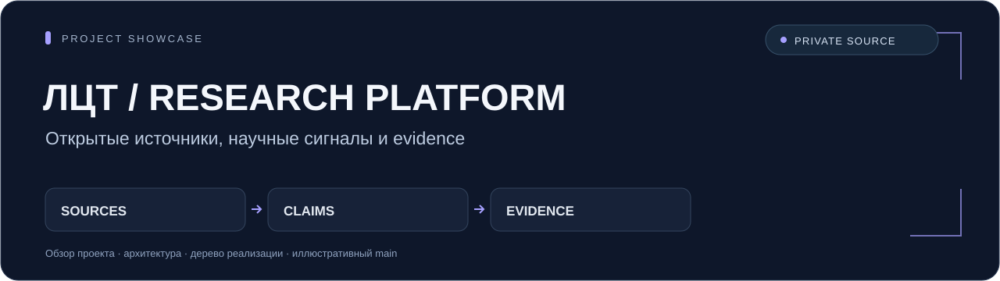

# ЛЦТ · технологические сигналы

**Исследовательский запрос → источники → утверждения и доказательства.**



Портфолио-витрина серверного конвейера исследования открытых источников и слабых технологических сигналов. Проект связывает запросы, сбор документов, аналитические кандидаты, доказательства и историю исследований. Полная реализация backend хранится в приватном репозитории.

`Research pipeline` · `Open sources` · `Claims / evidence` · `History`

[Архитектура](docs/ARCHITECTURE.md) · [Полное дерево приватной реализации](docs/SOURCE_TREE.md) · [Синтетический пример](examples/main.py)

**Размещение:** полная реализация — `xn0n/lct-research-platform` (private); эта витрина — `xn0n/lct-research-platform-showcase` (public). Имя и история приватной реализации сохраняются.

## Что реализовано в backend

| Область | Возможности |
| --- | --- |
| Исследовательские запросы | Создание, статусы, история, сессии и проверка доступа |
| Фоновая работа | Celery-задачи, события выполнения, попытки и идемпотентность |
| Сбор источников | Backend-адаптеры arXiv, OpenAlex, прямых ссылок и web-канала |
| Подготовка документов | Ограничения загрузки, нормализация, хеширование и защита от SSRF |
| Аналитические структуры | Источники, документы, фрагменты, кандидаты, claims и evidence |
| Проверка результата | Связи утверждений с входными документами, API результатов и исключённых кандидатов |

Технологии приватной реализации: **Python, FastAPI, SQLAlchemy, PostgreSQL, Celery, Redis и Alembic**.

## Фактическая граница анализа

Текущий `PipelineService` вызывает **`StubAnalysisGateway`**. Такой анализ воспроизводим и помогает проверять контракты, но не является обученной ML-моделью или живой LLM-интеграцией. Сборщики открытых источников существуют отдельно; при отсутствии live-документов конвейер может использовать синтетический fallback. Режим `live` сам по себе не доказывает работу реальной аналитической модели.

`frontend/`, `collectors/` и `ml/` — заготовки. Реализованные сборщики находятся в backend. Готовый пользовательский интерфейс и обученные веса в этой версии отсутствуют.

## Попробовать иллюстрацию

Нужен **Python 3.10+**, только стандартная библиотека:

```bash
python examples/main.py
```

Пример связывает вымышленные документы и утверждения, затем выводит этапы условного исследования. Он не использует настоящий backend, его `StubAnalysisGateway`, открытые источники, ML или очереди. Проверка ссылок в примере не устанавливает научную обоснованность или качество классификации.

## Публичная поставка и конфиденциальность

В витрине доступны архитектурное объяснение, полное дерево tracked-путей приватной реализации и новый синтетический пример. Исходники backend, тесты, схемы, модели, prompts, зависимости, Docker и конфигурация не распространяются. Пути в дереве служат документацией и не ссылаются на доступные здесь файлы реализации.

Рабочие адреса сервисов, документы для нейросетевых прогонов, командные материалы, персональные данные, базы и закрытые результаты исключены. **Детали закрытого рабочего контура не разглашаются.** Runtime backend и качество настоящего анализа эта витрина не подтверждает.
