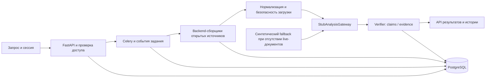

# Архитектура платформы технологических сигналов

Схема описывает приватный backend. Публичный пример является новым синтетическим сценарием и не исполняет компоненты диаграммы.

| Приватная область | Ответственность |
| --- | --- |
| `backend/app/api/` | Сессии, запросы, результаты, история, технологии и health |
| `backend/app/services/collection/` | Адаптеры, нормализация, ограничения загрузки и SSRF-защита |
| `backend/app/services/analysis/` | Контракт анализа, stub, схемы и verifier |
| `backend/app/services/pipeline.py` | Координация этапов исследования |
| `backend/app/tasks/` | Celery и обработка задач |
| `backend/app/models/`, `schemas/` | Хранение и контракты API |
| `backend/alembic/` | Версии схемы |

`StubAnalysisGateway` является фактическим аналитическим адаптером текущего конвейера. Наличие live-сборщиков не превращает stub в живую модель; синтетический fallback возможен при отсутствии собранных live-документов.

Verifier проверяет соответствие ответа контрактам и связям с входными документами. Такая проверка не равна доказанному качеству ML-классификации или независимой научной верификации утверждений.

Каталоги `frontend/`, `collectors/`, `ml/` и модельные placeholders не заявляются реализованным UI или обученным ML. Закрытая инфраструктура и материалы рабочих исследований здесь не описываются.

[Вернуться к витрине](../README.md) · [Дерево приватной реализации](SOURCE_TREE.md)
